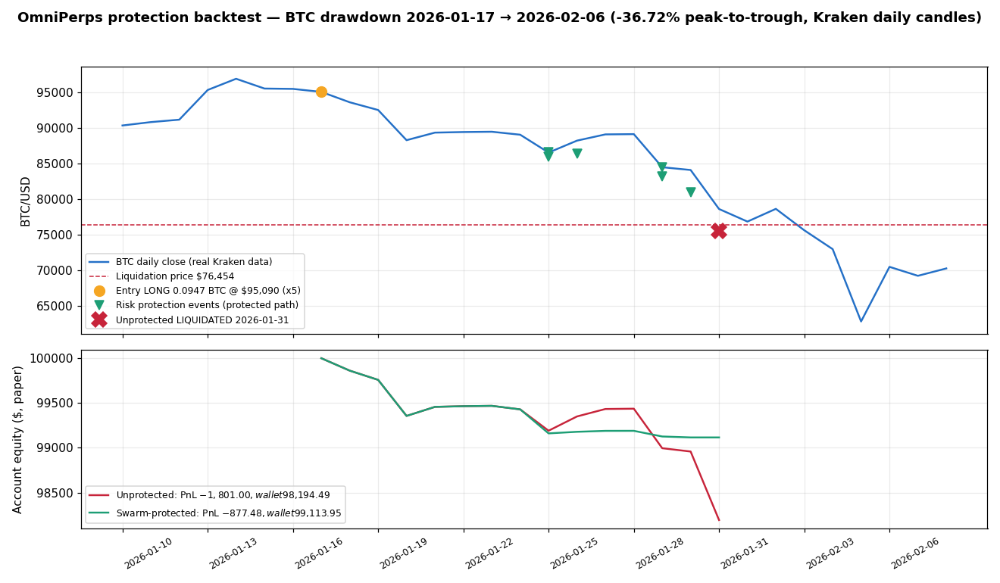

# Backtest — does the protection ladder actually save the position?

**Run it yourself:** `node scripts/backtest.js` (fetches the data
live from Kraken, re-runs both paths, rewrites
`docs/backtest-run.json` and `docs/images/backtest.png`).

## The window (chosen by rule, not by hand)

Data: Kraken public OHLC, pair **XBTUSD**, interval **1440 (daily
candles)**. Selection rule: the sharpest peak-to-trough drawdown —
running peak **high** to a later **low** — completing within
**≤ 21 days**, among candles dated ≥ 2024-01-01.

| | |
|---|---|
| Peak day | **2026-01-17** (high **$95,600.00**; entry close **$95,089.90**) |
| Trough day | **2026-02-06** (low **$60,500.00**) |
| Drawdown | **−36.72 %** peak-to-trough over 20 days |

## Methodology (plainly)

- **Entry:** LONG at the close of the peak day. Size comes from the
  swarm's own machinery: the Signal Agent's standard proposal
  template (~$18k notional target, 5x leverage) passed through
  `RiskAgent.review()` — which returned **approve_reduced** (halved
  the size, liquidation distance 19.6 % < 20 % caution band).
  Result: **0.0947 BTC ×5**, margin **$1,801.00**, liquidation price
  **$76,454.19**. Identical entry for both paths. The entry isolates
  the protection layer — the claim under test. It is *not* a claim
  that the Signal Agent would have bought the exact top.
- **Stepping:** for each daily candle after entry, up to and
  including the trough day, the mark is set to the candle **low**
  first (worst adverse print of the day for a long), then to the
  candle **close**. The engine checks liquidation at every mark in
  both paths. The intra-candle path is approximated by low → close.
- **Path A — UNPROTECTED:** the position is simply held. No
  `Swarm.onPrice`, no intervention of any kind.
- **Path B — SWARM-PROTECTED:** `Swarm.onPrice(mark)` (the live
  protection code) runs at every mark: force-reduce 50 % when
  liquidation distance < 12 %, force-close when < 7 %. Protection
  is evaluated at every mark (no cooldown) in this daily-granularity
  replay.
- Any position still open at the trough day's close is closed
  there. Engine taker fees (0.05 %) apply in both paths.

## Results (from the actual run — `docs/backtest-run.json`)

| | Unprotected | Swarm-protected |
|---|---|---|
| Liquidated? | **YES — 2026-01-31 at $75,600** (that day's low) | **No** |
| Protection events | — | force-reduce ×2 on 2026-01-25, force-reduce 2026-01-26, force-reduce ×2 on 2026-01-29, **force-close 2026-01-30** |
| Realised PnL | **−$1,801.00** (100 % of margin) | **−$877.48** (48.7 % of margin) |
| Final wallet (paper, started $100,000) | $98,194.49 | $99,113.95 |
| Margin preserved vs Path A | — | **$923.52** of the $1,801 margin survived |

## What this does and does not prove

It proves the protection ladder, running the production code path,
turned a total margin loss into a partial loss on one real, severe
historical drawdown — the position was fully exited by the ladder
on 2026-01-30, one day before the unprotected position was
liquidated. It does **not** prove profitability, that the ladder
wins in every market path, or anything about live execution: entry
timing is prescribed, prices are daily candles (low→close
approximation), and settlement is the paper engine. The numbers
above are exactly what the script printed; re-running it re-fetches
the data and re-derives the window by the same rule.
